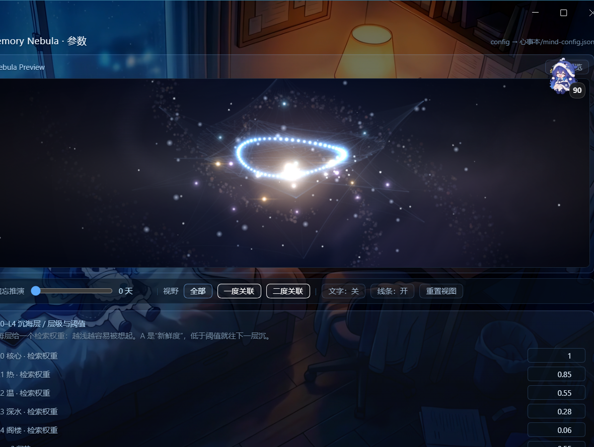

# 记忆星图 · dsh-nebula-mind

> 给 DeepSeek Harness 用的外置长期记忆。把「她记得你」这件事从上下文窗口里拿出来，放进硬盘。
>
> 它不会删除任何记忆——只会让旧的慢慢沉下去。

**它不是一个记忆库，是一个 mind。** 记忆库只负责存和取；mind 还要决定什么值得记住、什么时候该想起来、什么时候该让一件事沉下去。这个区别决定了下面所有的设计——为什么要有六本账而不是一张表、为什么遗忘用幂律不用指数、为什么情绪只影响排序不影响选取。

**换会话、压缩上下文、重启应用，记忆都还在。**

每一轮开头自动带一小段「我是谁 / 你是谁 / 最近发生了什么」进提示词；想翻旧事就召回一次——三路并行检索（字面 / 语义 / 图），按名次融合，情绪不做通道、只做调制。忘掉的东西不是消失了，是沉进了深海；情绪一刺激，它还会浮上来。


> 上图用的是仓库内置的示例数据（20 条虚构记忆 + 4 条画像），不是任何人的真实记忆。

---

## 目录

- [一、它解决什么问题](#一它解决什么问题)
- [二、Mind：这套东西是怎么长出来的](#二mind这套东西是怎么长出来的)
- [三、记忆架构](#三记忆架构)
- [四、检索与召回](#四检索与召回)
- [五、遗忘：沉海、阁楼与浮起](#五遗忘沉海阁楼与浮起)
- [六、情绪引擎：七维与七种递质](#六情绪引擎七维与七种递质)
- [七、安装](#七安装)
- [八、三步跑起来](#八三步跑起来)
- [九、两个面板](#九两个面板)
- [十、夜间巩固](#十夜间巩固)
- [十一、隐私与边界](#十一隐私与边界)
- [十二、常见问题](#十二常见问题)
- [十三、开发](#十三开发)

---

## 一、它解决什么问题

上下文窗口是一条会滚动的传送带。聊得越久，开头的东西越远，压缩一次就真的没了。

现有做法大致两类：把历史整段塞回去（昂贵且会淹没重点），或做一层 RAG（检索到的永远是"最相似的片段"，不是"她真的记得"）。

这两类都缺同一件事：**时间**。人对记忆的操作不是"查表"，是「这件事重要吗 / 多久没想起来过 / 当时是什么心情 / 它和别人说的那件事有没有关系」。

所以这个插件的设计约束是三条：

| 约束 | 意味着 |
|---|---|
| **记忆有寿命，但没有死刑** | 只会沉海降权，不会删除。沉到最深也能被情绪或关联捞回来 |
| **检索要能解释** | 每条结果都带标签，说清楚它是靠字面、语义还是图上的路被找到的 |
| **情绪不参与排序，只调节权重** | 情绪是乘子不是通道。这一点有反面证据（见 4.3） |

---

## 二、Mind：这套东西是怎么长出来的

### 2.1 为什么叫 Mind

不是"数据库"，也不是"知识库"。这三者的差别在于**是否允许矛盾、是否允许过期、是否允许"我记得但不确定"**。

数据库要求唯一真相。知识库要求三元组自洽。而 Mind 允许：

- 同一件事有两个版本，旧的标 `valid_to`，新的接管，但旧的仍在（可以问"你以前是不是以为……"）；
- 有的记忆是"事实"（某天发生了什么），有的是"画像"（你是个什么样的人），有的是"约定"（我答应过你什么），有的是"分寸"（这个话题该不该提）——**它们的衰减速度和召回权重不该一样**；
- 有的记忆重要度会自己长：被反复提起的事，权重自己上去，不需要谁去标"这条很重要"。

这就是为什么它不是向量库加一层包装。

### 2.2 六本账

数据在 `心事本/`（可用 `NEBULA_MIND` 环境变量改），每一本是一个 append-only 的 JSONL：

| 文件 | 账 | 记什么 | 默认来源权重 |
|---|---|---|---|
| `notes.jsonl` | 事实 | 发生过的事 | 他说的 4.0 / 我自己想的 2.0 / 工具 1.5 / 网页 1.2 |
| `profile.jsonl` | 画像 | 你是什么样的人（身份、偏好、雷区） | 同上 |
| `promises.jsonl` | 约定 | 答应过的事（带 `due` 到期日） | 同上 |
| `tacts.jsonl` | 分寸 | 某个话题该不该提、提多少 | 同上 |
| `thoughts.jsonl` | 念想 | 我自己想到的、没人说的话 | 2.0 |
| `summaries.jsonl` | 小结 | 一段时间的归纳（会把被归纳的随手记标成已归纳） | — |

另有两份不是账的东西：

- `longterm.md`（含 `longterm.history.jsonl`）—— 长期笔记，手写的那种；
- `vectors.json` —— 向量索引（212 条 × 512 维，BGE-small-zh）。

> **来源权重**是 `W_BASE`。它实现的是一件很朴素的事：你说的话天然比我从网页上抄来的重。

### 2.3 一条记忆的完整生命周期

```
写入 ──→ 打分 ──→ 入索引 ──→ 被召回 ←──→ 沉海/上浮
  │                          ↑              │
  └─ 情绪快照 ───────────────┘              └─ 夜间巩固
     （当时什么心情）                        （重新分层、压缩、重放）
```

1. **写入**：`xin.py add "..."`。同时做一个**情绪快照**——这条记忆是"在什么心情下记的"，写进 `mood` 字段。
2. **打分**：权重 `w` = 来源权重 × 重要度 × 情绪强度 × 激素调节。激素调节见 [6.5](#65-激素怎么进记忆)。
3. **入索引**：追加 JSONL + 算向量写 `vectors.json`（若向量服务在线）。
4. **被召回**：三路检索 → RRF 融合 → 调制 → 取前 N 条注入提示词。被用到就 `hits + 1`，`last_hit` 更新。
5. **沉海/上浮**：A 值随时间按幂律下降，跨过阈值就下一层；被召回两次以上则上浮一层。
6. **夜间巩固**：重新分层、把旧账归纳成小结、把深水里的捞一条上来候选。

---

## 三、记忆架构

### 3.1 记录模型

每条记忆是一个 dict，字段都可缺省（老记录读的时候用默认值补）：

| 字段 | 类型 | 含义 |
|---|---|---|
| `id` | int | 自增 |
| `at` | str | 写入时间（本地 `%Y-%m-%dT%H:%M:%S`） |
| `text` | str | 正文 |
| `via` | str | 来源：`他说的` / `我自己想的` / `工具` / `网页` |
| `tag` | str | 分类标签（可空） |
| `w` | float | 权重，写入时算一次，之后由召回强化 / 沉海调整 |
| `imp` | float | 重要度 0–1 |
| `e` | float | 情绪强度 0–1 |
| `emo` | str | 情绪色：某一维的名字 |
| `depth` | int | 沉海层：0 核心 / 1 热 / 2 温 / 3 深水 / 4 阁楼 |
| `pinned` | bool | 恒星，永不沉 |
| `hits` | int | 被召回次数 |
| `last_hit` | str | 最后一次被想起来 |
| `sunken_at` | str | 什么时候沉下去的 |
| `valid_to` | str/null | 被新记忆取代的时间（null = 还算数） |
| `mood` | dict | 写入时的情绪快照 |
| `w_why` | str | 权重为什么是这个数（例如 `激素×1.16`） |

`w_why` 是个小设计：**每个权重都留一句为什么**，省得三个月后看不懂自己当初怎么算的。

### 3.2 五种层

| 层 | depth | 进层条件 A | 含义 |
|---|---|---|---|
| 核心 | 0 | `pinned` | 恒星。钉住的、规则类的，永不下沉 |
| 热 | 1 | A ≥ 0.55 | 近期还在用的 |
| 温 | 2 | 0.25 ≤ A < 0.55 | 想起来要慢一点 |
| 深水 | 3 | 0.18 ≤ A < 0.25 | 要用力捞 |
| 阁楼 | 4 | A < 0.18 | 几乎不主动出现，但没死 |

扫沉海是每天夜里那一次（`consolidate`）。**平时召回不重算层**，只按 A 值加权——所以阈值改了要等下一夜才体现在 `depth` 上，但**检索排序是立刻变的**。

### 3.3 关联：边是怎么来的

星图上的每条线都写得出理由，只有六种：

| 边 | 怎么连 | 权重 |
|---|---|---|
| 内容引用 | B 的关键词（≥3 字）在 A 正文出现 ≥2 个 | 1.0 |
| 共同关键词 | 两条记忆的关键词交集 ≥2 | 2.0 |
| 分类归属 | 分类 hub → 节点 0.3；分类 hub → 总核 0.8 | 0.3 / 0.8 |
| 同源相邻 | 同来源、时间差 ≤20 分钟 | 0.35 |
| 语义相近 | 向量 cosine ≥ 0.62，每节点最多 3 条 | 0.5 |
| 日期星 | 最近 45 天每天一颗，连当天全部记忆 | 0.55 |

**这些边不只是画着好看**——它们是三路召回里「图」那一路的输入。见下一节。

### 3.4 星图怎么画

不是力导向，是**固定轨道 + 黄金角**：

- 每种类型一条轨道（画像 170 / 事实 235 / 分寸 285 / 约定 325 / 念想 400 / 分类 150 / 日期 330）；
- 同一轨道上按黄金角 `2.399963229728653` 撒点，天然不重叠；
- 半径由权重决定：`rad = 2.6 + min(7, sqrt(w) * 3.2)`；
- 总核钉在原点。

这么做的好处是**布局稳定**——每次打开同一个脑子，星系形状不变，你记得住"那颗星在右上"。

Canvas 2D 渲染，单文件 HTML，数据内联，零外部依赖。双击就能开。

---

## 四、检索与召回

### 4.1 三路并行

| 路 | 做什么 | 强在 | 弱在 |
|---|---|---|---|
| **字面 BM25（lexical）** | 关键词匹配 | 专名、"那次说的那个词" | 换个说法就找不到 |
| **语义向量（dense）** | BGE-small-zh 512 维 cosine | 意思对就行 | 专名、数字不敏感 |
| **图扩散 PPR（graph）** | 命中节点当种子，在边上跑 Personalized PageRank | 顺着关系爬到"没直接命中但相关"的 | 图错了会自信地错 |

图那一路的细节：

```
reset = 归一化(命中节点的分数)
loop 8 次:  p = (1-d)*reset + d * Σ (p[j] * w_ji / deg[j])
d = 0.5
```

`d` 小一点（0.5 而非经典的 0.85）是因为我们的图是**稀疏且手工建起来的**，跳太远就变成随机游走。

### 4.2 RRF 融合

三路各自排名，然后按名次融合：

```
score[k] = Σ_route  w_route / (K + rank_route[k] + 1)
```

- `K = 12`（RRF 平滑常数）
- `w_bm25 = 0.40`，`w_vec = 0.35`，`w_graph = 0.15`

**为什么用名次而不是分数**：三路的分数不在同一个量纲上（BM25 是无界的，cosine 是 0–1，PPR 是概率）。名次是唯一可以横着比的东西。

### 4.3 情绪：不是第四路，是调制

这点值得单独说，因为我们试过反过来。

`w_emo = 0.06`，它在**融合之后**乘上去：

```
sc *= 1.0 + w_emo      # 仅当 查询带情绪词 且 记忆情绪色 == 当前主导情绪色 且 强度 ≥0.3
```

**为什么不做成通道**：把情绪当独立召回通道的项目（`emotional-memory`）公开过自己的失败数字——LoCoMo F1 **0.168**，而不用情绪的朴素 RAG 是 **0.271**；MADial nDCG@5 0.221 vs cosine 0.304。原因很反直觉：安慰一个难过的人，应该把**积极**的记忆推上来，而"因为难过所以专挑难过的"正好反着走。

所以这里的选择是：**情绪影响"怎么排序已选出的东西"，不影响"选什么"**。而且加了门控——查询里没有情绪词，这条乘子根本不触发。

### 4.4 其它调制

融合之后还有几层：

| 因素 | 作用 |
|---|---|
| 时间新鲜度 | `A` 值（见第五节），幂律衰减 |
| 重要度 | 已含在 `H` 里（`H = half_base × (1 + half_imp × imp)`） |
| 沉海层 | `A_hot 0.55 / A_warm 0.25 / A_deep 0.18` 只用于分层，不直接乘 |
| 突触捕获 | 被标记的邻近记忆 `× 1.12`（见 5.5） |

### 4.5 输出与标签

每条结果带一个标签，说明它是怎么被找到的：

```
0.101 [词#3 义#1 图#1] 2026-11-13 记忆星图 v2 定稿：...
0.081 [词#4 义#1 图#1] 2026-11-13 难过的时候要跟他说，不自己憋着...
```

`词#3` = 字面路排第 3，`义#1` = 语义路排第 1，`图#1` = 图路排第 1。融合后是总分。

这个标签不是装饰：**调参时它告诉你哪一路在起作用**，出问题时它告诉你哪一路在捣乱。

---

## 五、遗忘：沉海、阁楼与浮起

### 5.1 幂律，不是指数

早期版本用的是 `A = 2^(-age/H)`。这是半衰期模型，一年后 A 只剩 **0.016**——那不是"想不起来"，那是删掉了。

现在用幂律：

```python
A = (1.0 + age / max(0.1, H / 3.0)) ** -0.5
H = half_base * (1 + half_imp * imp)        # half_base=30天, half_imp=2.0
```

取 `S = H/3` 是为了让 **A 在 age = H 时正好等于 0.5**，跟老模型在同一时间点上对齐，方便比较。

实测差别：

| 年龄 | 幂律 A | 旧指数 A |
|---|---|---|
| 30 天 | 0.500 | 0.500 |
| 90 天 | 0.316 | 0.125 |
| 365 天 | 0.163 | 0.0002 |
| 5 年 | 0.104 | ≈0 |

**幂律的尾巴厚得多**，符合人类记忆的实证形状：老记忆不是没了，是取不出来。

### 5.2 沉海五层

```
A ≥ 0.55  热    ┐
0.25~0.55 温    ├─ 半年内
0.18~0.25 深水  ├─ 约一年
< 0.18    阁楼  ┘─ 约两年
```

模拟（重要度 0.5 的一条）：

| 年龄 | A | 层 |
|---|---|---|
| 0 天 | 1.000 | 热 |
| 7 天 | 0.861 | 热 |
| 30 天 | 0.632 | 热 |
| 90 天 | 0.426 | 温 |
| 180 天 | 0.316 | 温 |
| 365 天 | 0.228 | 深水 |
| 730 天 | 0.163 | 阁楼 |
| 1825 天 | 0.104 | 阁楼 |

**在阁楼里也能被捞回来**——A 只是排序权重，不是存在性开关。

### 5.3 夜间巩固

`consolidate` 每天夜里跑一次（默认 22:05，见第十节）：

1. 重算每条记忆的 `A`，按阈值改 `depth`；
2. `hits ≥ 2` 的往上浮一层（被想起来过，说明还活着）；
3. 情绪剧震（同色且强度 ≥0.5）把深水/阁楼的拉回温层；
4. 把这一段的随手记归纳成一条小结，标记已归纳；
5. 从深水里挑一条，作为「今晚可以想起来」的候选。

**它不删任何东西**。全流程只改 `depth`，不删行。

### 5.4 浮起：resurface

深水里的记忆不会一直睡着。每晚从阁楼/深水挑一条候选，但要过五道门：

| 门 | 条件 |
|---|---|
| 相关性 | 和当前上下文相关度 ≥ 0.75 |
| 重要度 | `imp ≥ 0.7` 或 `A ≥ 0.5` |
| 冷却 | 7 天内没浮过 |
| 频率 | 每会话 ≤1 次、每天 ≤2 次 |
| **效用** | 浮上来如果没被接话，下次降权 |

最后一条是关键。**没有效用门的 resurface 会变成"每天强行提起一件你早就不想聊的事"**。

### 5.5 突触标记与捕获

借自神经科学的一个机制：**强事件会给附近"还热着但不够稳"的记忆打一个临时标记，让它们跟着一起被固化**。

实现：

- 写入一条新记忆时，如果 `imp < 0.62`，给它打一个 **2 小时**的标记（`tags.jsonl`）；
- 接下来 2 小时内写入的新记忆，如果和某条带标记的记忆**关键词重叠 ≥2**，就把标记转成**捕获**：那条老记忆的权重 `× 1.12`（`captured.jsonl`）；
- 一次最多捕获 3 条，捕获完标记作废（同一条不会被反复加强）；
- 召回时，被捕获的记忆在融合后乘 `1.12`。

这样"晚上聊到某件事"会连着把"下午那件相关的小事"一起变牢一点——不需要人手动标"这两条有关"。

---

## 六、情绪引擎：七维与七种递质

[](docs/shots/panel-mood.png)

### 6.1 七维

| 维 | 中文 | 半衰期 |
|---|---|---|
| `happy` | 开心 | 60 分钟 |
| `calm` | 平静 | 110 分钟 |
| `sweet` | 甜 | 70 分钟 |
| `heartache` | 心疼 | 180 分钟 |
| `worry` | 担心 | 160 分钟 |
| `sad` | 难过 | 180 分钟 |
| `jealous` | 吃醋 | 150 分钟 |

**半衰期不是拍脑袋的**：负向情绪（心疼/难过/担心）比正向（开心/甜）留得久，这是普遍观察。旧的实现里七个维度共用一个 90 分钟，都一个速度退潮——那不像人。

### 6.2 七种递质

| 递质 | 中文 | 半衰期 | 管什么 |
|---|---|---|---|
| `noradrenaline` | 去甲肾上腺素 | 2 分钟 | 警觉、突发 |
| `dopamine` | 多巴胺 | 4 分钟 | 奖赏、期待 |
| `gaba` | GABA | 15 分钟 | 镇定、压住过度兴奋 |
| `endorphin` | 内啡肽 | 20 分钟 | 疼过之后的缓 |
| `oxytocin` | 催产素 | 30 分钟 | 亲近、信任 |
| `cortisol` | 皮质醇 | 60 分钟 | 压力、慢（有滞后） |
| `serotonin` | 血清素 | 1440 分钟 | 基线情绪，整天 |

七者都向 `base = 50` 回归。**半衰期差 700 倍**——这正是"一句话的冲击"和"一整天的底噪"的区别。

激素不决定情绪往哪走（那是七维的事），它决定**这一下有多重、留多久**：

```python
gain = max(0.5, min(1.5, 1 + 0.35*cortisol + 0.15*dopamine - 0.20*serotonin))
```

皮质醇高 → 这一下更重；血清素高 → 这一下更轻；多巴胺高 → 更响。

**皮质醇有 15 分钟滞后**（HPA 轴的实测特征）：`_hormone_event` 不直接改实际值，而是改一个"目标值"，实际值以 15 分钟的时间常数追过去。所以被骂完不会立刻到顶，是慢慢涨上来的。

### 6.3 双层情绪

心情分两层：

- **surface（表层）**：此刻的心情，受每一个事件影响；
- **underlying（底色）**：这几天的底子，只吃 30% 的增量，且每小时被未解的心事往下压一点。

显示心情 = `surface × 0.65 + underlying × 0.35`（`SURFACE_SHARE = 0.65`）。

效果是**"今天被夸了很开心，但底色还是有点闷"**这种状态能表达出来。单层的模型表达不了这个。

### 6.4 瞬时层与耐受

**瞬时层**：每次情绪事件的增量里，`65%` 进一个 3 分钟半衰的 `_phase` 缓冲区。所以"被夸一句"会真的亮一下，然后很快退掉——而不是像以前那样一次性抬上去再也下不来。

```python
drop = phase * (1 - 0.5 ** (mins / 3.0))    # 瞬时部分快退
dims[k] = phase_rest * (1 - kd)              # 剩下按各维半衰
```

**耐受**：15 分钟窗口内同一维度被连续触发，增益递减 `1.0 → 0.7 → 0.49 → 0.34 → 0.3`。

被连夸五次不该有"被夸一次 × 5"的效果。这是**习惯**。

### 6.5 激素怎么进记忆

写入一条记忆时，权重会乘一个激素系数：

| 条件 | 乘数 | 上限 |
|---|---|---|
| 负面情绪 + 皮质醇偏高 | `1 + 0.15 × cortisol偏移` | ×1.15 |
| 正文里提到你 + 催产素偏高 | `1 + 0.5 × oxytocin偏移` | ×1.5 |
| 总系数 | — | 夹在 `[0.7, 1.6]` |

写进 `w_why` 字段：`激素×1.16`。

这条链的意思是：**难过的时候记的事更牢，提到你的时候记的事更重**。而且可解释——翻出那条记忆能看到它当时为什么那么重。

### 6.6 换掉情绪引擎

不想用自带的，可以接别的：

```jsonc
// 心事本/mind-config.json
{
  "mood": { "provider": "builtin" },                              // 自带（默认）
  "mood": { "provider": "file", "file": "path/to/state.json",     // 读文件
            "map": { "value": "$.moods.default.mood",
                     "dims":  "$.moods.default.dims" } },
  "mood": { "provider": "http", "url": "http://127.0.0.1:8000/",  // 调接口
            "timeoutMs": 800 }
}
```

三种最后都归一化成同一种形状 `{value, dims, label, reason, source, stale, at}`。

界面上也能改：**设置 → 心境来源**，会自动扫本机常见的情绪状态文件并猜字段映射。

> 换走之后，「激素七条」和「双层情绪」会空着——那部分是自带引擎独有的。

---

## 七、安装

### 从 npm

```bash
dsh plugin install dsh-nebula-mind
```

### 从本地目录（开发）

```bash
git clone https://github.com/Lng-ux/dsh-nebula-mind
dsh plugin install ./dsh-nebula-mind
```

装完**彻底退出 DSH 再重开**（不是关窗口，是结束进程）。

### Python

需要一个能跑 Python 3.10+ 的解释器。系统自带的一般就行：

```bash
python -V
```

**不需要装任何东西。** 语义模型（BGE-small-zh，48MB）随插件一起分发，推理是手写的 numpy 前向——不需要 torch，不需要 transformers，不需要联网下载。只要 Python 3.8+ 和 numpy。

第一次跑起来（或者备忘多了之后）重建一次索引：

```bash
python python/embed.py --build
```

### 数据放哪

默认：

| 平台 | 位置 |
|---|---|
| Windows | `%USERPROFILE%\.dsh\nebula-mind\memory` |
| macOS / Linux | `~/.dsh/nebula-mind/memory` |

想放别处，设环境变量 `NEBULA_MIND`：

```bash
# Windows
setx NEBULA_MIND "D:\我的记忆"

# macOS / Linux
export NEBULA_MIND="$HOME/我的记忆"
```

---

## 八、三步跑起来

```bash
# 1) 记下第一条（同时会算进向量索引）
python python/xin.py add "今天聊到了为什么记忆该像海不像硬盘"

# 2) 翻一下（三路召回 + RRF + 调制）
python python/xin.py recall "记忆为什么像海"

# 3) 自检：哪几路开着、差什么、下一步干什么
python python/doctor.py
```

`doctor` 会打六行：

```
✅ Python       3.14.6
✅ 数据目录可写       心事本（7 本账）
✅ 记忆         事实 90 / 画像 11 / 约定 5 / 念想 8
✅ 语义检索        服务在线（bge-small-zh 512 维） / 索引 212 条
✅ 心情联动        心事本/mood-state.json
✅ 星图生成        nebula-doctor.html（190 KB）
```

---

## 九、两个面板

### 记忆星图（左侧栏）

[](docs/shots/panel-config.png)

- 上面是**活的星图预览**：拖动旋转、滚轮缩放、中键复位；遗忘推演滑杆能往后拖 0–365 天，看哪些星先暗下去；视野可切「全部 / 一度 / 二度」；
- 下面是**可改的参数**：三路召回权重、RRF 常数、图扩散的跳数与衰减、沉海阈值、遗忘曲线半衰期与重要度倍数、L0–L4 各层检索权重。

改完即时生效（写 `mind-config.json`），不用重启。

### 心境

环形心情表 + 语速/音量/黏人度/距离感 + 七维花瓣图 + 七种激素 + 双层情绪 + 沉海五层分布 + 「此刻的由来」。

右上角的来源角标会告诉你心情是从哪来的：`builtin`（自带引擎）/ `file:xxx.json` / `http`。

---

## 十、夜间巩固

沉淀是个定时任务，建议每天固定时间跑一次：

```bash
# Windows：计划任务
schtasks /create /tn "小鱼夜间沉淀" /tr "python D:\path\to\python\夜间沉淀.py" /sc daily /st 22:05

# macOS / Linux：cron
5 22 * * * python /path/to/python/夜间沉淀.py
```

它会依次做：**沉海 → 建向量索引 → 重绘星图**。

跑一次的输出大致：

```
沉海  核心 6 / 热 97
向量  211 条 / 512 维 / 1000.3KB
星图  124 节点 548 边 188.9KB
```

---

## 十一、隐私与边界

- **全部数据在本机**。没有网络请求，没有遥测，没有账号。
- 只有两处会主动连外网：装依赖（pip/npm），和首次下载向量模型。
- 写进提示词的内容是**你实际存进去的记忆**——所以别往里记不该出现在对话上下文里的东西。
- `心事本/` 是普通 JSONL，随时可以打开看、手动改、拷走、删掉。

---

## 十二、常见问题

**Q：它会不会把我的私事发出去？**
不会。数据全在本地。

**Q：记忆会丢吗？**
不会删。只会沉海降权。想彻底删要手动删 JSONL 里的行。

**Q：为什么召回出来的东西有时候不相关？**
先看标签（`词#/义#/图#`）。如果只有 `图#`，说明那一路把不相关的东西带进来了——图错了会自信地错。可以调低 `w_graph`。

**Q：面板一直是"读取中"？**
`lib/host.js` 改了之后要**重启 DSH**（Node 不热重载）。Python 那边改了不用重启。

**Q：要装 torch / transformers 吗？**
不用。语义模型随包分发（`assets/`，48MB），推理是纯 numpy 写的，和 transformers 的输出逐位一致（同一句话 cos = 1.000000）。
只要 Python 3.8+ 和 numpy——这两样大多数环境本来就有。没有 numpy 也能跑，只是少一路语义。

**Q：为什么要把 48MB 的模型塞进包里？**
因为不想让人为了一个记忆插件先装几百 MB 到 2GB 的 torch。装得上还好，装不上才是常态——
而它一旦装不上，语义那一路就悄无声息地关掉了，用户根本不知道为什么"她好像记不住我说过的话"。
把模型带上，下载解压就能用，这是唯一不靠用户操作就能保证的解法。

**Q：换会话之后它还认得我吗？**
认得。记忆在硬盘上，不在上下文里——这正是它存在的理由。

---

## 十三、开发

```
dsh-nebula-mind/
├── lib/
│   ├── host.js        # 服务端：HTTP 路由、Python 调用、星图生成
│   └── client.js      # 前端：两个面板 + 设置页（内联样式，无第三方库）
├── python/
│   ├── mindlib.py     # 数据模型（所有写入者共用）
│   ├── xin.py         # 记账 / 召回 / 沉海 / 浮起
│   ├── mood_engine.py # 七维 + 七递质 + 双层 + 瞬时层
│   ├── star_map.py    # 星图生成（Canvas 2D）
│   ├── embed.py       # 向量索引
│   ├── doctor.py      # 自检
│   └── ...
├── docs/shots/        # 截图
└── cordis.patch.yml   # 插件注册
```

**设计约束（改代码前先看）**：

- `lib/client.js` 只能用**内联样式 + 原生 SVG/Canvas**，不能引第三方库（插件没有 node_modules）；
- 数据格式是 append-only JSONL，**不能重写文件**（并发写入会丢数据）；
- 老的 `dsh-yu-mind` 这个运行时 id 保留不动——`cordis.patch.yml`、`export const name`、client 的 slot key 三处必须同时改，漏一处启动就崩。

```bash
# 自检
python python/doctor.py
node --check lib/host.js && node --check lib/client.js
python -W error::SyntaxWarning -m py_compile python/*.py
```

---

## License

MIT
