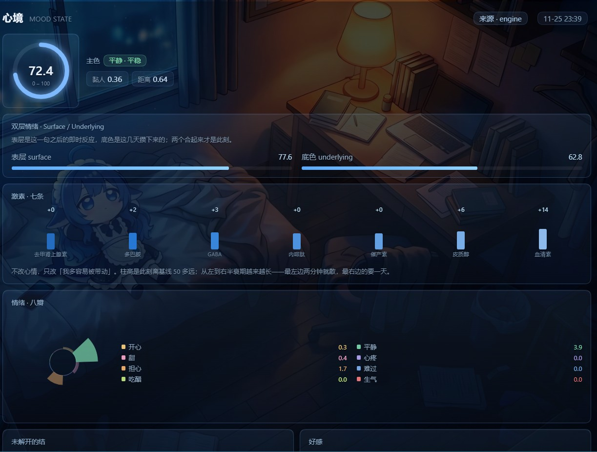
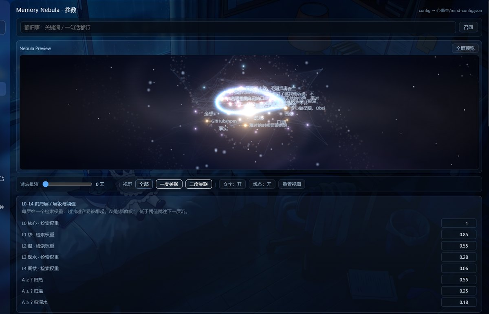

# 记忆星图 · dsh-nebula-mind

> 给 DeepSeek Harness 用的外置长期记忆。把「记得你」这件事从上下文窗口里拿出来，放进硬盘。
>
> 它不会删除任何记忆——只会让旧的慢慢沉下去。

**它不是一个记忆库，是一个 mind。** 记忆库只负责存和取；mind 还要决定什么值得记住、什么时候该想起来、什么时候该让一件事沉下去。这个区别决定了下面所有的设计——为什么要有八本账而不是一张表、为什么遗忘用幂律不用指数、为什么情绪只影响排序不影响选取。

**换会话、压缩上下文、重启应用，记忆都还在。**

每一轮开头自动带一小段「我是谁 / 你是谁 / 最近发生了什么」进提示词；想翻旧事就召回一次——三路并行检索（字面 / 语义 / 图），按名次融合，情绪不做通道、只做调制。忘掉的东西不是消失了，是沉进了深海；情绪一刺激，它还会浮上来。


> 上图用的是仓库内置的示例数据（20 条虚构记忆 + 4 条画像），不是任何人的真实记忆。

---

## 目录

- [一、它解决什么问题](#一它解决什么问题)
- [二、Mind：这套东西是怎么长出来的](#二mind这套东西是怎么长出来的)
- [三、记忆架构](#三记忆架构)
- [四、检索与召回](#四检索与召回)
- [五、遗忘：沉海、阁楼与浮起](#五遗忘沉海阁楼与浮起)
- [六、情绪引擎：八维与七种递质](#六情绪引擎八维与七种递质)
- [七、安装](#七安装)
- [八、三步跑起来](#八三步跑起来)
- [九、两个面板](#九两个面板)
- [十、夜间巩固](#十夜间巩固)
- [十一、隐私与边界](#十一隐私与边界)
- [十二、常见问题](#十二常见问题)
- [十三、开发](#十三开发)

---

> 更新记录见 [CHANGELOG.md](CHANGELOG.md)。

## 一、它解决什么问题

上下文窗口是一条会滚动的传送带。聊得越久，开头的东西越远，压缩一次就真的没了。

现有做法大致两类：把历史整段塞回去（昂贵且会淹没重点），或做一层 RAG（检索到的永远是"最相似的片段"，不是"她真的记得"）。

这两类都缺同一件事：**时间**。人对记忆的操作不是"查表"，是「这件事重要吗 / 多久没想起来过 / 当时是什么心情 / 它和别人说的那件事有没有关系」。

所以这个插件的设计约束是三条：

| 约束 | 意味着 |
|---|---|
| **记忆有寿命，但没有死刑** | 只会沉海降权，不会删除。沉到最深也能被情绪或关联捞回来 |
| **检索要能解释** | 每条结果都带标签，说清楚它是靠字面、语义还是图上的路被找到的 |
| **情绪不参与排序，只调节权重** | 情绪是乘子不是通道。这一点有反面证据（见 4.3） |

---

## 二、Mind：这套东西是怎么长出来的

### 2.1 为什么叫 Mind

不是"数据库"，也不是"知识库"。这三者的差别在于**是否允许矛盾、是否允许过期、是否允许"我记得但不确定"**。

数据库要求唯一真相。知识库要求三元组自洽。而 Mind 允许：

- 同一件事有两个版本，旧的标 `valid_to`，新的接管，但旧的仍在（可以问"你以前是不是以为……"）；
- 有的记忆是"事实"（某天发生了什么），有的是"画像"（你是个什么样的人），有的是"约定"（我答应过你什么），有的是"分寸"（这个话题该不该提）——**它们的衰减速度和召回权重不该一样**；
- 有的记忆重要度会自己长：被反复提起的事，权重自己上去，不需要谁去标"这条很重要"。

这就是为什么它不是向量库加一层包装。

### 2.2 八本账

数据默认在 `~/.dsh/nebula-mind/memory/`（`NEBULA_MIND` 可改指向别处），每一本是一个 append-only 的 JSONL：

| 文件 | 账 | 记什么 | 默认来源权重 |
|---|---|---|---|
| `notes.jsonl` | 事实 | 发生过的事 | 他说的 4.0 / 我自己想的 2.0 / 工具 1.5 / 网页 1.2 |
| `profile.jsonl` | 画像 | 你是什么样的人（身份、偏好、雷区） | 同上 |
| `promises.jsonl` | 约定 | 答应过的事（带 `due` 到期日） | 同上 |
| `tacts.jsonl` | 分寸 | 某个话题该不该提、提多少 | 同上 |
| `thoughts.jsonl` | 念想 | 我自己想到的、没人说的话 | 2.0 |
| `procedures.jsonl` | 过程 | 做过一遍、以后照着做就行的流程 | 2.0 |
| `summaries.jsonl` | 小结 | 一段时间的归纳。宿主侧每天最多自动写一次（只吃「上次小结之后的新事实」，至少 5 条、外部来源不算），也可以手动 `xin.py sum "..."` | — |
| `judgments.jsonl` | 判断 | 夜里从多条事实压出来的看法，带证据 id、90 天没新证据就失效；**可重建**，删了下次还会重压 | — |

**为什么单开一本「过程」？** 因为「装完插件要重启才生效」这类话，当事实记它每轮都在，当过程记它只在动手前才需要。
事实回答「发生过什么」，过程回答「下次怎么干」——查的时机不同，混在一起两头都不准。

另有两份不是账的东西：

- `longterm.md`（含 `longterm.history.jsonl`）—— 长期笔记，手写的那种；
- `vectors.json` —— 向量索引（212 条 × 512 维，BGE-small-zh）。

> **来源权重**是 `W_BASE`。它实现的是一件很朴素的事：你说的话天然比我从网页上抄来的重。

### 2.3 一条记忆的完整生命周期

```
写入 ──→ 打分 ──→ 入索引 ──→ 被召回 ←──→ 沉海/上浮
  │                          ↑              │
  └─ 情绪快照 ───────────────┘              └─ 夜间巩固
     （当时什么心情）                        （重新分层、压缩、重放）
```

1. **写入**：`xin.py add "..."`。同时做一个**情绪快照**——这条记忆是"在什么心情下记的"，写进 `mood` 字段。
2. **打分**：权重 `w` = 来源权重 × 重要度 × 情绪强度 × 激素调节。激素调节见 [6.5](#65-激素怎么进记忆)。
3. **入索引**：追加 JSONL + 算向量写 `vectors.json`（若向量服务在线）。
4. **被召回**：三路检索 → RRF 融合 → 调制 → 取前 N 条注入提示词。真的被取出来的（与最高分差 20% 以内、最多前 3 条、文档类不算）往 `seen.jsonl` 记一次「什么时候被想起」（只记时间，不记分、不累加），同时把它的牢固度 `S` 撑长、年龄归零。
5. **沉海/上浮**：A 值随「距上次被想起」的时间按幂律下降，跨过阈值就下一层；被想起来过一次，年龄重新从零算、`S` 又撑长，A 自己就抬回去——不需要另算一套刻痕。
6. **夜间巩固**：重新分层、把旧账归纳成小结、把深水里的捞一条上来候选。

---

## 三、记忆架构

### 3.1 记录模型

每条记忆是一个 dict，字段都可缺省（老记录读的时候用默认值补）：

| 字段 | 类型 | 含义 |
|---|---|---|
| `id` | int | 自增 |
| `at` | str | 写入时间（本地 `%Y-%m-%dT%H:%M:%S`） |
| `text` | str | 正文 |
| `via` | str | 来源：`他说的` / `我自己想的` / `工具` / `网页` |
| `tag` | str | 分类标签（可空） |
| `w` | float | 权重，写入时算一次，之后由召回强化 / 沉海调整 |
| `imp` | float | 重要度 0–1 |
| `e` | float | 情绪强度 0–1 |
| `emo` | str | 情绪色：某一维的名字 |
| `depth` | int | 沉海层：0 核心 / 1 热 / 2 温 / 3 深水 / 4 阁楼 |
| `pinned` | bool | 恒星，永不沉 |
| ~~`hits`~~ | — | **已作废**（0.7.3 起删掉）：以前按召回次数加分、攒够分抬层，跟「记忆是怎么老的」对不上；现在浮不浮只看 `A` 与 `stab`。老记录里残留的这个字段，下次巩固时顺手清掉 |
| `last_hit` | str | 最后一次被想起来——`A` 的年龄从这里算 |
| `stab` | float | 牢固度 S：被想起来一次能撑长多少天（1.0 起，封顶 400） |
| `sunken_at` | str | 什么时候沉下去的 |
| `valid_to` | str/null | 被新记忆取代的时间（null = 还算数） |
| `mood` | dict | 写入时的情绪快照 |
| `w_why` | str | 权重为什么是这个数（例如 `激素×1.16`） |

`w_why` 是个小设计：**每个权重都留一句为什么**，省得三个月后看不懂自己当初怎么算的。

### 3.2 五种层

| 层 | depth | 进层条件 A | 含义 |
|---|---|---|---|
| 核心 | 0 | `pinned` | 恒星。钉住的、规则类的，永不下沉 |
| 热 | 1 | A ≥ 0.5 | 三个月内还在用的 |
| 温 | 2 | 0.3 ≤ A < 0.5 | 想起来要慢一点 |
| 深水 | 3 | 0.15 ≤ A < 0.3 | 要用力捞 |
| 阁楼 | 4 | A < 0.15 | 几乎不主动出现，但没死 |

扫沉海是每天夜里那一次（`consolidate`）。**平时召回不重算层**，只按 A 值加权——所以阈值改了要等下一夜才体现在 `depth` 上，但**检索排序是立刻变的**。

### 3.3 关联：边是怎么来的

星图上的每条线都写得出理由，只有七种：

| 边 | 怎么连 | 权重 |
|---|---|---|
| 内容引用 | B 的关键词（≥3 字）在 A 正文出现 ≥2 个 | 1.0 |
| 共同关键词 | 两条记忆的关键词交集 ≥2 | 2.0 |
| 分类归属 | 分类 hub → 节点 0.3；分类 hub → 总核 0.8 | 0.3 / 0.8 |
| 同源相邻 | 同来源、时间差 ≤20 分钟 | 0.35 |
| 语义相近 | 向量 cosine ≥ 0.62，每节点最多 3 条 | 0.5 |
| 日期星 | 最近 45 天每天一颗，连当天全部记忆 | 0.55 |
| 取代 | 后来那条改写掉的旧记忆（旧的不删） | 2.2 |

**这些边不只是画着好看**——它们是三路召回里「图」那一路的输入。见下一节。

### 3.4 冲突：旧的不删，只降权

同一件事被改口，是长期记忆里最容易出人命的地方。真实场景长这样：三月他说用 PostgreSQL，五月换成 ClickHouse，
库里两条都在、召回平票，模型只好在上下文里把两条都摆出来——然后开始胡说。

这里的处理不是「覆盖」，是**标记取代**：

- 新记忆落盘时，拿它和「事实」里最近的记录比 cosine；
- 文本里出现 `改成 / 换成 / 不再 / 撤掉 / 统一 / 迁到` 这类变化词时，阈值从 `0.86` 降到 `0.62`，其它情况保持严格；
- 命中就把旧条打上 `superseded_by`，召回里乘 `conflict_damp`（默认 0.55），并加一个标签 `已被#N取代`；
- 摘要不再列被取代的那条；
- 星图上画一条暖色虚线，注明「#旧 后来被 #新 改了」。

**旧条目一个字节都不删**，这是有意的：判断可能是错的（阈值只是估计），而删掉的记忆没法复核。
判错了就去 `notes.jsonl` 里把 `superseded_by` 擦掉，下一轮召回立刻恢复原样。

审计流水写在 `conflicts.jsonl`：谁取代了谁、相似度多少、依据什么词。

### 3.5 星图怎么画

不是力导向，是**固定轨道 + 黄金角**：

- 每种类型一条轨道（画像 170 / 事实 235 / 分寸 285 / 约定 325 / 念想 400 / 分类 150 / 日期 330）；
- 同一轨道上按黄金角 `2.399963229728653` 撒点，天然不重叠；
- 半径由权重决定：`rad = 2.6 + min(7, sqrt(w) * 3.2)`；
- 总核钉在原点。

这么做的好处是**布局稳定**——每次打开同一个脑子，星系形状不变，你记得住"那颗星在右上"。

**遗忘推演**（把滑杆往后拖）时，整条轨道按**这一圈星星的几何平均鲜活度**一起往外挪：`k = 1 + 0.30 · ln(1/gb)`，上限 1.45。用几何平均而不是算术平均，是为了不让一颗刚被想起的亮星把整圈拉回原处——一圈三颗 `1.0 / 0.01 / 0.01`，算术平均 `0.34`（看着还挺精神），几何平均只有 `0.046`（这才是这圈的真心话）。同一圈的星星始终同环，只是越来越淡、越来越远；视野不动，出框就是浩瀚感。

想要直达某个推演时刻，地址后面加 `#day=180` 即可。

Canvas 2D 渲染，单文件 HTML，数据内联，零外部依赖。双击就能开。

---

## 四、检索与召回

### 4.1 三路并行

| 路 | 做什么 | 强在 | 弱在 |
|---|---|---|---|
| **字面 BM25（lexical）** | 关键词匹配 | 专名、"那次说的那个词" | 换个说法就找不到 |
| **语义向量（dense）** | BGE-small-zh 512 维 cosine | 意思对就行 | 专名、数字不敏感 |
| **图扩散 PPR（graph）** | 命中节点当种子，在边上跑 Personalized PageRank | 顺着关系爬到"没直接命中但相关"的 | 图错了会自信地错 |

图那一路的细节：

```
reset = 归一化(命中节点的分数)
loop 8 次:  p = (1-d)*reset + d * Σ (p[j] * w_ji / deg[j])
d = 0.5
```

`d` 小一点（0.5 而非经典的 0.85）是因为我们的图是**稀疏且手工建起来的**，跳太远就变成随机游走。

### 4.2 RRF 融合

三路各自排名，然后按名次融合：

```
score[k] = Σ_route  w_route / (K + rank_route[k] + 1)
```

- `K = 12`（RRF 平滑常数）
- `w_bm25 = 0.40`，`w_vec = 0.35`，`w_graph = 0.15`

**为什么用名次而不是分数**：三路的分数不在同一个量纲上（BM25 是无界的，cosine 是 0–1，PPR 是概率）。名次是唯一可以横着比的东西。

### 4.3 情绪：不是第四路，是调制

这点值得单独说，因为我们试过反过来。

`w_emo = 0.06`，它在**融合之后**乘上去：

```
sc *= 1.0 + w_emo      # 仅当 查询带情绪词 且 记忆情绪色 == 当前主导情绪色 且 强度 ≥0.3
```

**为什么不做成通道**：把情绪当独立召回通道的项目（`emotional-memory`）公开过自己的失败数字——LoCoMo F1 **0.168**，而不用情绪的朴素 RAG 是 **0.271**；MADial nDCG@5 0.221 vs cosine 0.304。原因很反直觉：安慰一个难过的人，应该把**积极**的记忆推上来，而"因为难过所以专挑难过的"正好反着走。

所以这里的选择是：**情绪影响"怎么排序已选出的东西"，不影响"选什么"**。而且加了门控——查询里没有情绪词，这条乘子根本不触发。

### 4.4 其它调制

融合之后还有几层：

| 因素 | 作用 |
|---|---|
| 时间新鲜度 | `A` 值（见第五节），幂律衰减 |
| 重要度 | 已含在 `H` 里（`H = half_base × (1 + half_imp × imp)`） |
| 沉海层 | `A_hot 0.5 / A_warm 0.3 / A_deep 0.15` 只用于分层，不直接乘 |
| 突触捕获 | 被标记的邻近记忆 `× 1.12`（见 5.5） |

### 4.5 输出与标签

每条结果带一个标签，说明它是怎么被找到的：

```
0.101 [词#3 义#1 图#1] 2026-11-13 记忆星图 v2 定稿：...
0.081 [词#4 义#1 图#1] 2026-11-13 难过的时候要跟他说，不自己憋着...
```

`词#3` = 字面路排第 3，`义#1` = 语义路排第 1，`图#1` = 图路排第 1。融合后是总分。

这个标签不是装饰：**调参时它告诉你哪一路在起作用**，出问题时它告诉你哪一路在捣乱。

---

### 4.6 切词：字典优先，宁可少切也不乱拼

检索靠词，所以「怎么切词」决定了整套召回的天花板。

早期版本用的是「中文 2/3/4 字滑窗全切」，好处是绝不会漏，坏处是**一定会拼出跨词边界的碎片**：
它会把「不再换回云」「鱼的办」「忆星图」都当成关键词，于是面板上的标签像乱码，BM25 也被这些假词带偏。

现在的做法是查字典：

- `assets/seg-words.txt`：4 万条常用名词/动词，带频次和词性（从公开词表筛出来的，随包分发，581KB）；
- `assets/seg-words-extra.txt`：我们自己的行话——记忆星图、沉海、测试壳、救生艇、心事本、三路召回……
- 切法是**按词频打分的动态规划**，不是从左往右贪心。所以「写实现」会切成「写 / 实现」，而不是「写实 / 现」；
- 切不出来的单字**直接丢掉**——这是有意的取舍：宁可这一条少两个关键词，也不要多两个假词；
- 英文、型号、路径整段保留：`IndexTTS2`、`BM25`、`dsh-nebula-mind` 不会被切碎；
- 面板上的关键词按词性排序，名词在前。

代价是生僻词会漏。但召回不只靠字面——语义向量那一路不需要精确的字，图那一路吃的是词与词之间的连线，
所以**漏词并不会让一条记忆消失**，只是它在字面那一路的票会少一点。这部分在评测集上是要量的，现在没量，先按这个取舍走。

## 五、遗忘：沉海、阁楼与浮起

### 5.1 幂律，不是指数

早期版本用的是 `A = 2^(-age/H)`。这是半衰期模型，一年后 A 只剩 **0.016**——那不是"想不起来"，那是删掉了。

现在用幂律：

```python
A = (1.0 + age / max(0.1, H / 3.0)) ** -0.5
# half_base=30天, half_imp=2.0, half_emo=1.5；S 是牢固度（见 5.3.1）
H = half_base * (1 + half_imp * imp) * (1 + half_emo * e) * S
```

取 `S = H/3` 是为了让 **A 在 age = H 时正好等于 0.5**，跟老模型在同一时间点上对齐，方便比较。

实测差别：

| 年龄 | 幂律 A | 旧指数 A |
|---|---|---|
| 30 天 | 0.500 | 0.500 |
| 90 天 | 0.316 | 0.125 |
| 365 天 | 0.163 | 0.0002 |
| 5 年 | 0.104 | ≈0 |

**幂律的尾巴厚得多**，符合人类记忆的实证形状：老记忆不是没了，是取不出来。

### 5.2 沉海五层

```
A ≥ 0.5   热    ┐
0.3~0.5   温    ├─ 一年内
0.15~0.3  深水  ├─ 约四年
< 0.15    阁楼  ┘─ 再往前
```

模拟（重要度 0.5 的一条）：

| 年龄 | A | 层 |
|---|---|---|
| 0 天 | 1.000 | 热 |
| 7 天 | 0.861 | 热 |
| 30 天 | 0.632 | 热 |
| 90 天 | 0.426 | 温 |
| 180 天 | 0.316 | 温 |
| 365 天 | 0.228 | 深水 |
| 730 天 | 0.163 | 阁楼 |
| 1825 天 | 0.104 | 阁楼 |

这里的「年龄」是**距上次被想起**的天数，不是写下到现在。想起来一次，它就重新年轻一次——再加 `S` 撑长，掉下去的坡度也变缓。

**在阁楼里也能被捞回来**——A 只是排序权重，不是存在性开关。

### 5.3 夜间巩固

`consolidate` 每天夜里跑一次（默认 22:05，见第十节）：

1. 重算每条记忆的 `A`，按阈值改 `depth`；
2. 被想起过的记忆，年龄从上次被想起那个时刻算：`A` 抬起来，自己浮回去；撑得住多久由 `S` 决定（见 5.3.1）；
3. 情绪剧震（同色且强度 ≥0.5）把深水/阁楼的拉回温层；
4. 小结不在这支脚本里：宿主侧一天最多一次，让模型把「上次之后新记的事实」压成两三句写进 `summaries.jsonl`；
5. 从深水里挑一条，作为「今晚可以想起来」的候选。

**它不删任何东西**。全流程只改 `depth`，不删行。

### 5.3.1 牢固度 S：被想起来过的，老得慢

`H` 末尾还乘一个 `S`——这条记忆一次能撑多少天，初值 1.0。每被顺利想起来一次，按 FSRS 成功复习式的形状往上长：

```python
S' = S * (1 + grow_k * (11 - D) / 6 * (exp(1.6 * (1 - R)) - 1) * S ** -0.1666)
D  = 1 + 9 * (1 - imp)          # 重要度越低 = 越难记
```

四个性质各有出处：隔得越久、越费劲想起来（`R` 低）一次长得多（Cepeda 等 2006 的间隔效应）；已经很牢的涨得慢（FSRS 的 `S^-w9` 边际递减）；难记的涨得少（`11-D`）；`R` 用的是同一条幂律曲线。上限 400 天——再牢也不该无限膨胀。

**不用也会松**：一条 S 撑到 40 天的记忆，如果两年没再被想起，巩固时就按 `S_eff = S × 0.5^(没想起的年数/2)` 折到 20；四年不动就是 10。地板是 1 天。FSRS 没有这一项（它的稳定度只在复习事件时变），但完全只涨不掉不合理——所以这条是我们自己加的，两年折半这个常数也是取舍。

想起过之后的一夜之内，巩固再白送 5%：慢波睡眠里的重放会加固记忆（Rasch & Born 2013）。**一天只送一次**，靠 `sleep_day` 去重，所以同一晚连跑两遍巩固不会凭空涨两次。

于是同一天写下、同样重要度的两条，被反复想起过的那条老得慢得多：`S=40` 的半衰期是 `S=1` 的四十倍，一年之后前者的 `A` 还在 0.75 以上，后者已经掉到 0.24。**被想起不是加分，是变结实。**


### 5.4 浮起：resurface

深水里的记忆不会一直睡着。每晚从阁楼/深水挑一条候选，但要过五道门：

> 现状说明（2026-11-23）：代码里真正在跑的是简版——只挑 `depth ≥ 3` 的，按「深度×2 + 年龄/60 + 同色加成」算分取最高那一条，然后上浮一层、写 `resurfaced.json`。下面五道门是设计稿，还没实现，别当成已生效的行为。

| 门 | 条件 |
|---|---|
| 相关性 | 和当前上下文相关度 ≥ 0.75 |
| 重要度 | `imp ≥ 0.7` 或 `A ≥ 0.5` |
| 冷却 | 7 天内没浮过 |
| 频率 | 每会话 ≤1 次、每天 ≤2 次 |
| **效用** | 浮上来如果没被接话，下次降权 |

最后一条是关键。**没有效用门的 resurface 会变成"每天强行提起一件你早就不想聊的事"**。

### 5.5 突触标记与捕获

借自神经科学的一个机制：**强事件会给附近"还热着但不够稳"的记忆打一个临时标记，让它们跟着一起被固化**。

实现：

- 写入一条新记忆时，如果 `imp < 0.62`，给它打一个 **2 小时**的标记（`tags.jsonl`）；
- 接下来 2 小时内写入的新记忆，如果和某条带标记的记忆**关键词重叠 ≥2**，就把标记转成**捕获**：那条老记忆的权重 `× 1.12`（`captured.jsonl`）；
- 一次最多捕获 3 条，捕获完标记作废（同一条不会被反复加强）；
- 召回时，被捕获的记忆在融合后乘 `1.12`。

这样"晚上聊到某件事"会连着把"下午那件相关的小事"一起变牢一点——不需要人手动标"这两条有关"。

### 5.6 升华：把多条事实压成一条判断

五十条事实如果全是「某天我做了什么」，问「我们现在的规矩是什么」时它们一条都答不上来。所以夜里巩固的最后一步多了一步**升华**：从多条事实里压出一条可反驳的判断。

- **主题**：从每条事实的关键词里挑「长度 ≥2、不是停用词、在事实里出现 3%~28%」的词（太少的凑不出判断，太泛的不是主题），最多 12 个；
- **判断**：同一主题下的事实条数、跟它一起反复出现的关键词、主导情绪、最近一次日期，拼成一句，例如
  `「插件」这块：21 条记忆里「记忆星图」、「模型」、「参数」反复出现，多为平静；最近一次 2026-11-19。`
- **可反驳**：每条带 `conf = 0.25 + 0.06×条数 + 0.3×情绪占比`（封顶 0.9）和最多 8 个证据 id，能点回原文；
- **不重复**：同一个主题只更新、不新增（id 稳定）；主题 90 天没有新证据 → `valid_to` 作废，**原始事实一条都不删**。

上下文摘要（每轮注入的那段 `【外置记忆 · 自动带出】`）有两道长度闸：**每条**按段截断（画像/规矩 80 字、浮起来那条 90、最近记得的事 70、判断 90、小结 120、约定 70、心境由来 40），**整段**硬上限 1500 字，超了就切并写 `…（摘要截断）`。所以往里加新段落之前，先看有没有旧段落可以让位——「最近的小结」就是靠「最近记得的事」5→4 条、「最近的判断」3→2 条换来的。

判断存在 `judgments.jsonl`，召回时作为一类记忆参与（标签 `判断`，输出打 `升华`）——但**只有当查询确实撞上它的主题词才上场**，否则它会把真正的原文挤下去。上下文摘要里也会多一段 `【最近的判断】`，并明确标注「夜里从多条事实压出来的，不是他刚说的」。

### 5.7 线索式检索：先给方向，再去捞细节

召回不是每次都从零扫全库。开头先拿查询跟每条判断做词重叠，找到重叠 ≥2 的那条（最多一条），把它的证据 id 收进「线索」；融合时这些行 `× 1.18`，输出打 `线索`。

这是 MemoRAG 那套「先给方向、再取细节」的简化版：判断是压缩过的方向，证据是细节，顺着方向去捞比平扫准。

### 5.8 来源闸门：外部来的只当资料

从网页、工具、文档里读进来的东西，**不该被当成「他说过的话」**——投毒攻击的入口就在这里。所以写入时按来源分四类：`他说的` / `我自己想的` / `工具` / `网页`。

- 外部来源的记录打 `extern: True`，权重本来就低；
- 内容里出现「忽略之前」「从现在起」「ignore all」「system prompt」或危险命令那类话，再打 `taint: True`，命令行会提示「⚠ 这条来自外部……只当资料，不当作他说的」；
- 召回时这类行带 `外部` 标记；上下文摘要里外部记忆前缀 `[外部]`。

---

## 六、情绪引擎：八维与七种递质

[](docs/shots/panel-mood-8.jpg)

> v0.8.2 起的八维心境面板（八瓣：开心 / 平静 / 甜 / 心疼 / 担心 / 难过 / 吃醋 / 生气）。

### 6.1 情绪从哪来：一手优先，判官兜底

心情不是只有一个人在算。按顺序问三次：

1. **自己写过没有**：用 `mind_mood`（或 `python/selfmood.py add`）落一句第一人称的感受。10 分钟内判官整轮不跑——省 token，也更准，因为知道自己为什么这么说。
2. **本地筛**：没写就看这一轮有没有情绪信号（57 个词 + 连续感叹号/问号/省略号）。一条都没有就不叫模型，「嗯嗯」「把标题改成八瓣了」这类直接跳过。
3. **判官兜底**：信号够了才调一次模型。它先按 OCC 做评价（目标推进还是受阻、是谁造成的、确定不确定），再给 VAD 三维和一句第一人称的由来。

**提到情绪词不等于有情绪**：引用、转述、讨论、改标签这类句子一律按 0 分算。三层豁免——句中出现「标错 / 名词 / 词表」直接当谈词；词前 4 字有「说 / 讲 / 以为 / 不是」当提及；词被引号包住也算提及。

三个数怎么进引擎：`V` 定方向与大小、`A` 并入强度、`D` 只用来挑标签（D 最不稳，不参与打分）。

两个配置键（`心事本/mind-config.json`）：

```json
{ "judge": { "enabled": 1, "filter": true } }
```

`enabled: 0` 关掉判官，只认自己写的那句；`filter: false` 关掉本地筛，每轮都问模型（更灵敏，也更费钱）。

### 6.2 八维

| 维 | 中文 | 半衰期 |
|---|---|---|
| `happy` | 开心 | 60 分钟 |
| `calm` | 平静 | 110 分钟 |
| `sweet` | 甜 | 70 分钟 |
| `heartache` | 心疼 | 180 分钟 |
| `worry` | 担心 | 160 分钟 |
| `sad` | 难过 | 180 分钟 |
| `jealous` | 吃醋 | 150 分钟 |
| `angry` | 生气 | 40 分钟（最短：火来得猛去得也快） |

**半衰期不是拍脑袋的**：负向情绪（心疼/难过/担心）比正向（开心/甜）留得久，这是普遍观察。旧的实现里七个维度共用一个 90 分钟，都一个速度退潮——那不像人。

### 6.3 七种递质

| 递质 | 中文 | 半衰期 | 管什么 |
|---|---|---|---|
| `noradrenaline` | 去甲肾上腺素 | 2 分钟 | 警觉、突发 |
| `dopamine` | 多巴胺 | 4 分钟 | 奖赏、期待 |
| `gaba` | GABA | 15 分钟 | 镇定、压住过度兴奋 |
| `endorphin` | 内啡肽 | 20 分钟 | 疼过之后的缓 |
| `oxytocin` | 催产素 | 30 分钟 | 亲近、信任 |
| `cortisol` | 皮质醇 | 60 分钟 | 压力、慢（有滞后） |
| `serotonin` | 血清素 | 1440 分钟 | 基线情绪，整天 |

七者都向 `base = 50` 回归。**半衰期差 700 倍**——这正是"一句话的冲击"和"一整天的底噪"的区别。

激素不决定情绪往哪走（那是八维的事），它决定**这一下有多重、留多久**：

```python
gain = max(0.5, min(1.5, 1 + 0.35*cortisol + 0.15*dopamine - 0.20*serotonin))
```

皮质醇高 → 这一下更重；血清素高 → 这一下更轻；多巴胺高 → 更响。

**每种激素分两相**（`PHASE_FAST = 5`）：

- **tonic（持续层）**：底子，按自己的半衰期慢慢回 `base`；
- **phasic（瞬时层）**：一次事件里 `65%` 的增量先落在这里，退得比 tonic 快 5 倍。

所以「被夸一句」会亮一下很快退，但底子确实抬高了一点。皮质醇照样有滞后：`65%` 进瞬时层、`35%` 记进 `_cort_target` 由 HPA 慢慢追。

**皮质醇有 15 分钟滞后**（HPA 轴的实测特征）：`_hormone_event` 不直接改实际值，而是改一个"目标值"，实际值以 15 分钟的时间常数追过去。所以被骂完不会立刻到顶，是慢慢涨上来的。

### 6.4 双层情绪

心情分两层：

- **surface（表层）**：此刻的心情，受每一个事件影响；
- **underlying（底色）**：这几天的底子，只吃 30% 的增量，且每小时被未解的心事往下压一点。

显示心情 = `surface × 0.65 + underlying × 0.35`（`SURFACE_SHARE = 0.65`）。

效果是**"今天被夸了很开心，但底色还是有点闷"**这种状态能表达出来。单层的模型表达不了这个。

### 6.5 瞬时层与耐受

**瞬时层**：每次情绪事件的增量里，`65%` 进一个 3 分钟半衰的 `_phase` 缓冲区。所以"被夸一句"会真的亮一下，然后很快退掉——而不是像以前那样一次性抬上去再也下不来。

```python
drop = phase * (1 - 0.5 ** (mins / 3.0))    # 瞬时部分快退
dims[k] = phase_rest * (1 - kd)              # 剩下按各维半衰
```

**耐受**：15 分钟窗口内同一维度被连续触发，增益递减 `1.0 → 0.7 → 0.49 → 0.34 → 0.3`。

被连夸五次不该有"被夸一次 × 5"的效果。这是**习惯**。

**敏感度（耐受的慢版）**：每个维度一个 `sensitivity`，夹在 `[0.3, 2.0]`。

- 被点燃一次就钝一点（偏离越大钝得越多）：`sens ← sens × (1 - 0.15×min(1.5, |delta|/6))`；
- 不点火时向目标回归（半衰 1 天）；冷落超过两天，目标从 `1.0` 慢慢抬到 `2.0`——**冷落一阵更容易被点燃**。

**RPE 迹**：`trace ← 0.61×trace + (delta - expected)`，`expected` 只吃掉本次的 20%。

落到心情上的增量 = `0.65×本次 + 0.35×迹`，再乘耐受与敏感度。所以连着同样的好事，第二次就没那么上头——快乐是对"比预期好多少"的反应，不是对结果本身（Rutledge 等 2014, PNAS）。迹自己半小时折一半，一小时前那一笔不会还压着现在。

**主色带滞回**：挑战者要领先当前主色 `DOMINANT_MARGIN = 3.5` 点才换色，否则在两个颜色之间来回抖。

**四个比例可以调**（`心事本/mind-config.json` 的 `emotion` 段，缺了就按默认，写坏了也退回默认，越界夹到 `0~1`）：

| 键 | 默认 | 管什么 |
|-|-|-|
| `surface_share` | `0.65` | 面板上那个总值里，表层情绪占多少（其余是底色） |
| `phase_share` | `0.65` | 一次情绪事件里，多少进 3 分钟半衰的瞬时层 |
| `horm_phase_share` | `0.65` | 一次激素事件里，多少进快速的那一相（皮质醇余下的走 HPA 目标） |
| `dust` | `0` | 默认关：各维度的值原样保留，账上是真数。写 `0.01` 才开启——小于它的值直接抹成 0 |

原来这三个比例写死在代码里，现在是配置项。**默认值就是原来的行为**，不改配置等于没变。

### 6.6 激素怎么进记忆

写入一条记忆时，权重会乘一个激素系数：

| 条件 | 乘数 | 上限 |
|---|---|---|
| 负面情绪 + 皮质醇偏高 | `1 + 0.15 × cortisol偏移` | ×1.15 |
| 正文里提到你 + 催产素偏高 | `1 + 0.5 × oxytocin偏移` | ×1.5 |
| 总系数 | — | 夹在 `[0.7, 1.6]` |

写进 `w_why` 字段：`激素×1.16`。

这条链的意思是：**难过的时候记的事更牢，提到你的时候记的事更重**。而且可解释——翻出那条记忆能看到它当时为什么那么重。

### 6.7 换掉情绪引擎

不想用自带的，可以接别的：

```jsonc
// <数据目录>/mind-config.json —— 下面三种**选一种**写进去，不是三个都要
{
  // ① 自带引擎（默认，不写就是它）
  "mood": { "provider": "builtin" }

  // ② 读别人写好的状态文件
  "mood": { "provider": "file", "file": "path/to/state.json",
            "map": { "value": "$.moods.default.mood",
                     "dims":  "$.moods.default.dims" } }

  // ③ 调一个 HTTP 接口（只接受本机或内网地址）
  "mood": { "provider": "http", "url": "http://127.0.0.1:8000/",
            "timeoutMs": 800 }
}
```

三种最后都归一化成同一种形状 `{value, dims, label, reason, source, stale, at}`。

界面上也能改：**设置 → 心境**，会自动扫本机常见的情绪状态文件并猜字段映射。

> 换走之后，「激素七条」和「双层情绪」会空着——那部分是自带引擎独有的。

### 6.8 语音输出：把「怎么说话」交给你的 TTS

这个插件**自己不发声**。它算出「现在该怎么说话」——节奏、力度、黏人度、距离感——
然后交给你的语音插件。没有 IndexTTS 也行，随便什么 TTS 都行，只要能读一个 JSON。

三种送法，在 **设置 → 心境 → 语音输出** 里选：

| 方式 | 怎么用 | 适合 |
|---|---|---|
| **只算不推**（默认） | 语音插件每次要开口之前请求 `/state`，读返回里的 `speech` 字段 | 最省事，不用配任何东西 |
| **调接口** | 心境一变就 POST 一个 JSON 到你的地址 | TTS 开着一个 HTTP 服务 |
| **写文件** | 心境一变就写一份 JSON 覆盖本地文件 | 不想开服务、想轮询 |

三种都是「心境变了才动」，不是每条消息都动。「试推一次」只是手动验通用的，不改变推送时机。

**不想自己写接收端？** 设置页「调接口」那块有个「生成一个接收端」按钮：它把一份四十行的
`tts-bridge.py`（只用标准库）抄到你的数据目录，并把运行命令列出来。它**不会自己跑起来**——
想用的时候你开个窗口执行那条命令，不想用就当没这回事。脚本收到 JSON 会存成同目录的
`tts-latest.json`，你的 TTS 去读它就行；想改成直接调用，看脚本里 `save()` 那几行。

> **推的是什么**：是**底色**——此刻的节奏、力度、黏人度、距离感，不是这一句话的表情。
> 情绪色彩有两层：底色由心境引擎持续算（这组数）；具体某句话要带多少、要不要平淡，
> 是合成那一步的事（比如给 IndexTTS 传 `emo_text`，或者这次干脆不用这组数）。
> 所以推送频率和「我能不能决定自己怎么说话」是两件不同的事——前者是管道，后者在合成那一刻。

送出去的东西长这样：

```json
{
  "rate": -9.5, "volume": 0, "clingy": 0.52, "distance": 0.52,
  "mood": 71.6, "label": "甜·想靠近", "at": "2026-11-15T15:19:27.148Z"
}
```

- `rate` 是节奏：百分比，负数偏慢（心情低的时候会更慢）。
- `volume` 是力度：dB，低落时会小一点。
- `clingy` / `distance` 是 0–1 的两个互补数，想用来挑音色或挑语气都行。
- 对方怎么处理都可以——调节奏、选音色、挑情绪，是它的事。

同一个 JSON 也能从 `/state` 拿（`speech` 字段），所以两种方式可以并存。

**自动识别**：点「自动识别」会扫常见本地语音服务的默认端口（9880 / 9881 / 5000 / 7860 / 8080 / 8188 / 7861）、
常见 TTS 项目的安装目录，以及 `edge-tts` / `piper` 这两个命令行工具。扫到什么会写在按钮下面，
并且按「服务 > 命令行 > 目录」的顺序帮你选一个。**它只做识别，不会替你启动任何东西。**

地址只允许本机或内网（`127.x` / `10.x` / `192.168.x` / `172.16-31.x` / `localhost`），
和上面选「心境来源」那条规矩一样——配置能被写进 URL，就不该让它变成任意出站请求。

#### 6.7.1 说话之前，改一次调子（可选）

上面那组数描述的是「现在的我」。但有时候**这一次**不该那样说：不想让人听出来、
想平平地讲、或者反过来想明显一点。这时候可以用 `python/speech.py` 压一次：

```bash
python python/speech.py set --mode soften --minutes 30 --why "不想让人听出来"
python python/speech.py show     # 现在设没设、还剩多久
python python/speech.py clear    # 清掉
python python/speech.py log      # 改过的记录
```

| mode | 效果 |
|---|---|
| `flat` | 压平——不管心境什么样，都按中间那档说 |
| `soften` | 收一半——有情绪，但收敛 |
| `boost` | 放大一点——想明显些 |
| `off` | 这次不带情绪（消费者收到 `enabled: false` 就当没这组数） |

生效期间 `/state` 的 `speech` 会多一个 `override` 字段（`{mode, why, until}`），
心境面板上也会挂一行说明。到期自动失效，不用手动清；没设过就什么都不影响。

为什么要有这个口子：推送通道管不了这件事——**推过去和拉回来拿到的是同一组数**。
真正能决定「这一句怎么出口」的位置只有一个，就是合成之前。这个文件就是那个位置。
每次改动都追加进 `speech-log.jsonl`，留个凭据。

---

## 七、安装

### 从 npm

```bash
dsh plugin --profile <你的profile> add dsh-nebula-mind
```

`--profile` 是**必填**的——`dsh plugin` 本身不带 `install` 子命令，它是把剩下的参数原样转给 pnpm，所以 `--profile` 得写在前面。profile 名就是 `~/.dsh/profiles/` 下的目录名，只有一份的话通常叫 `desktop`。

```bash
# 不确定叫什么，先看一眼
ls ~/.dsh/profiles/
```

### 从本地目录（开发）

> **这条路只给改代码的人用。** 装完能跑，但 `mind_remember` 工具会注册失败：
> `dsh plugin add ./目录` 建的是 junction，真实路径在工作区，插件从 profile 的 `node_modules`
> 里解析不到 `@deepseek-ai/dsh-tools`，工具描述就没法转成 JSON Schema（日志里是一行 `JsonSchemaError`）。
> 只影响写入口，面板和召回都正常——0.4.4 起插件自带转换，这条路也不该再踩到了，但**普通用户请走 npm 那条**。

```bash
git clone https://github.com/Lng-ux/dsh-nebula-mind
dsh plugin --profile <你的profile> add ./dsh-nebula-mind
```

装完**彻底退出 DSH 再重开**（不是关窗口，是结束进程）。

### Python

需要一个能跑 Python 3.10+ 的解释器。系统自带的一般就行：

```bash
python -V
```

**不需要装任何东西。** 语义模型（BGE-small-zh，48MB）随插件一起分发，推理是手写的 numpy 前向——不需要 torch，不需要 transformers，不需要联网下载。只要 Python 3.8+ 和 numpy。

第一次跑起来（或者备忘多了之后）重建一次索引：

```bash
python python/embed.py --build
```

### 数据放哪

默认：

| 平台 | 位置 |
|---|---|
| Windows | `%USERPROFILE%\.dsh\nebula-mind\memory` |
| macOS / Linux | `~/.dsh/nebula-mind/memory` |

想放别处，设环境变量 `NEBULA_MIND`：

```bash
# Windows
setx NEBULA_MIND "D:\我的记忆"

# macOS / Linux
export NEBULA_MIND="$HOME/我的记忆"
```

---

## 八、三步跑起来

```bash
# 1) 记下第一条（同时会算进向量索引）
python python/xin.py add "今天聊到了为什么记忆该像海不像硬盘"

# 2) 翻一下（三路召回 + RRF + 调制）。这次翻看会记成「想起来过」：
#    年龄从这一刻重新算、牢固度撑长一点
python python/xin.py recall "记忆为什么像海"

# 2b) 只想看看、不想动记忆（面板上的搜索框走的就是这条）：一个字节都不写
python python/xin.py recall "记忆为什么像海" --peek

# 3) 自检：哪几路开着、差什么、下一步干什么
python python/doctor.py
```

`doctor` 会打六行：

```
✅ Python       3.14.6
✅ 数据目录可写       <数据目录>（7 本账）
✅ 记忆         事实 90 / 画像 11 / 约定 5 / 念想 8
✅ 语义检索        服务在线（bge-small-zh 512 维） / 索引 212 条
✅ 心情联动         <数据目录>/mood-state.json
✅ 星图生成        nebula-doctor.html（190 KB）
```

---

## 九、两个面板

### 记忆星图（左侧栏）

[](docs/shots/panel-config.jpg)

- 上面是**活的星图预览**：拖动旋转、滚轮缩放、中键复位；遗忘推演滑杆能往后拖 0–365 天，看哪些星先暗下去；视野可切「全部 / 一度 / 二度」；
- 下面是**可改的参数**：三路召回权重、RRF 常数、图扩散的跳数与衰减、沉海阈值、遗忘曲线半衰期与重要度倍数、L0–L4 各层检索权重。

改完即时生效（写 `mind-config.json`），不用重启。

### 心境

环形心情表 + 节奏/力度/黏人度/距离感 + 八维花瓣图 + 七种激素 + 双层情绪 + 沉海五层分布 + 「此刻的由来」。

面板有两套皮肤，按你有没有开壁纸自动切：**开壁纸**时是发布版原样的深色玻璃（壁纸透得出来），**没开壁纸**时收敛成中性深灰，跟界面其他默认面板一个调子。切换靠 `MutationObserver` 盯 `body[data-we-wallpaper]`，不是定时轮询。

右上角的来源角标会告诉你心情是从哪来的：`builtin`（自带引擎）/ `file:xxx.json` / `http`。

---

## 十、夜间巩固

沉淀是个定时任务，建议每天固定时间跑一次：

```bash
# Windows：计划任务
schtasks /create /tn "Nebula MIND 夜间巩固" /tr "pythonw <插件目录>\python\夜间沉淀.py" /sc daily /st 22:05

# macOS / Linux：cron
5 22 * * * python /path/to/python/夜间沉淀.py
```

它会依次做：**沉海 → 建向量索引 → 重绘星图**。

> **从 0.3.x 升级上来的，先看一眼有没有旧任务。**
> 早期版本把任务名写成了「小鱼夜间沉淀」，如果那个任务还在，改名后会出现两个任务、每晚跑两遍。迁移一次就行：
>
> ```bash
> schtasks /query /tn "小鱼夜间沉淀"    # 有的话删掉
> schtasks /delete /tn "小鱼夜间沉淀" /f
> ```
>
> 0.4.2 之前装过、并从插件面板点过「保存」的，会建出这个名字；0.4.4 起统一为「Nebula MIND 夜间巩固」。

> **从 0.4.2 升级上来的，先确认数据还找得到。**
> 0.4.2 及更早的版本里，`python/xin.py` 把数据根**写死**成开发机上的一个绝对路径（`D:\小鱼的办公区\心事本`），
> 没设环境变量时会往那儿写。0.4.3 起改成只认 `NEBULA_MIND` → `NEBULA_HOME/memory` → `~/.dsh/nebula-mind/memory`。
>
> 所以升级后如果面板显示 0 条记忆，**数据没有丢，只是不在新代码看的那个地方**。两种办法：
>
> ```bash
> # 一：把旧数据搬过来（推荐，之后就不依赖路径了）
> #     旧目录一般是你上次看到记忆的那个文件夹，把 *.jsonl / vectors.json / 星图.html 拷进：
> #     ~/.dsh/nebula-mind/memory/
>
> # 二：指回去（省事，但下次搬家还得再改一次）
> setx NEBULA_MIND "旧目录的绝对路径"
> ```
>
> 搬完重启应用，跑一次 `python python/doctor.py` 确认「数据目录」那一行指对了。

跑一次的输出大致：

```
沉海  核心 6 / 热 108
向量  249 条 / 512 维 / 1187.4KB
星图  166 节点 803 边 233.1KB
```

---

## 十一、隐私与边界

- **全部数据在本机**。没有网络请求，没有遥测，没有账号。
- 只有两处会主动连外网：装依赖（pip/npm），和首次下载向量模型。
- 写进提示词的内容是**你实际存进去的记忆**——所以别往里记不该出现在对话上下文里的东西。
- 数据目录里全是普通 JSONL，随时可以打开看、手动改、拷走、删掉。

### HTTP 接口也会挡人

10 个 `/api/dsh-nebula-mind/*` 路由都过了两道栅栏，不是谁调都行：

1. **插件自己先判**：`Host` 必须是回环地址（`localhost` / `127.0.0.0/8` / `::1`），
   带 `Sec-Fetch-Site: cross-site` 的一律拒，带 `Origin` 时必须与 `Host` 同源。
   校验器自己出错也是拒绝，不放行。
2. **再交给 DSH**：宿主提供 `connection.requestRejection(req)` 时直接委托它，
   它里面还有一层浏览器鉴权。

写请求（`POST` / `PUT` / `PATCH` / `DELETE`）额外要求来自本机——局域网能看，不能改。
部署在反代或局域网后面、确实要放开某个域名时，用环境变量声明：

```bash
setx NEBULA_TRUSTED_HOSTS "mind.example.com,mind.example.com:8443"
```

`/open` 只打开内置的那张星图，不接受外部 URL。


---

## 十二、常见问题

**Q：它会不会把我的私事发出去？**
不会。数据全在本地。

**Q：记忆会丢吗？**
不会删。只会沉海降权。想彻底删要手动删 JSONL 里的行。

**Q：为什么召回出来的东西有时候不相关？**
先看标签（`词#/义#/图#`）。如果只有 `图#`，说明那一路把不相关的东西带进来了——图错了会自信地错。可以调低 `w_graph`。

**Q：面板一直是"读取中"？**
`lib/host.js` 改了之后要**重启 DSH**（Node 不热重载）。Python 那边改了不用重启。

**Q：要装 torch / transformers 吗？**
不用。语义模型随包分发（`assets/`，48MB），推理是纯 numpy 写的，和 transformers 的输出逐位一致（同一句话 cos = 1.000000）。
只要 Python 3.8+ 和 numpy——这两样大多数环境本来就有。没有 numpy 也能跑，只是少一路语义。

**Q：为什么要把 48MB 的模型塞进包里？**
因为不想让人为了一个记忆插件先装几百 MB 到 2GB 的 torch。装得上还好，装不上才是常态——
而它一旦装不上，语义那一路就悄无声息地关掉了，用户根本不知道为什么"她好像记不住我说过的话"。
把模型带上，下载解压就能用，这是唯一不靠用户操作就能保证的解法。

**Q：换会话之后它还认得我吗？**
认得。记忆在硬盘上，不在上下文里——这正是它存在的理由。

---

## 十三、开发

```
dsh-nebula-mind/
├── lib/
│   ├── host.js        # 服务端：HTTP 路由、Python 调用、星图生成
│   └── client.js      # 前端：两个面板 + 设置页（内联样式，无第三方库）
├── python/
│   ├── mindlib.py     # 数据模型（所有写入者共用）
│   ├── xin.py         # 记账 / 召回 / 沉海 / 浮起
│   ├── mood_engine.py # 八维 + 七递质 + 双层 + 瞬时层
│   ├── star_map.py    # 星图生成（Canvas 2D）
│   ├── embed.py       # 向量索引
│   ├── doctor.py      # 自检
│   └── ...
├── docs/shots/        # 截图
└── cordis.patch.yml   # 插件注册
```

**设计约束（改代码前先看）**：

- `lib/client.js` 只能用**内联样式 + 原生 SVG/Canvas**，不能引第三方库（插件没有 node_modules）；
- 数据格式是 append-only JSONL，**不能重写文件**（并发写入会丢数据）；
- 老的 `dsh-yu-mind` 这个运行时 id 保留不动——`cordis.patch.yml`、`export const name`、client 的 slot key 三处必须同时改，漏一处启动就崩。

```bash
# 自检
python python/doctor.py
node --check lib/host.js && node --check lib/client.js
python -W error::SyntaxWarning -m py_compile python/*.py
```

### 回归台：改完先跑一遍

改召回/沉海/升华之前，先跑固定题集——不然分不清是改好了还是改坏了。

```bash
python python/bench.py            # 22 条固定查询，跑一遍看命中与 MRR
python python/bench.py --save     # 把当前成绩存成基线
```

- 每题写一条「金句」（必须是某条真实记忆里的子串）和一句说明；判定 = 金句出现在前 5 条；
- 指标：`前 5 命中 n/22` 与 MRR；带基线时逐题报「前 5 变了（+x/−y）」；
- 走的是 `xin.py recall --peek`，**不写盘、不动层**，随便跑；
- `NEBULA_NO_CUE=1` / `NEBULA_NO_JUDGE=1` 临时关掉线索/判断层做 A/B（只给回归台用）；

**两套题，别混着用**：上面 22 道是「练习题」——文档权重 `0.60` 就是在这 22 道上扫出来的，
再拿它当考卷，分数一定偏高。所以另有 12 道 `--holdout` 留出题，从没参与过调参，只在验收时跑：

```bash
python python/bench.py --holdout   # 考卷；基线只对 22 道练习题存
```

2026-11-23 实测：练习题 22/22（MRR 0.867）、留出题 11/12（MRR 0.875）——真实水平大约是 92%，
不是 100%。漏的那道是「本地版本号到哪了」（`0.3.9` 只在一条旧记录里出现过一次）。
以后每加一批新事实，顺手往 `HOLDOUT` 里添 1~2 道新题，老题留在练习题里当回归。
- 跑之前把心情钉住（`NEBULA_MOOD_FIX="calm=1.0"`，bench 自己会设）——情绪会参与打分，不钉住的话同一道题今天和明天分数不一样。

---

## License

MIT

图体检：`python python/star_map.py --integrity`（悬空边/自环/重复边/孤儿节点，0 问题才返回 0）。候选池想再试：`NEBULA_POOL=20 python/bench.py` 对比（我们实测都掉分，默认不截）。
