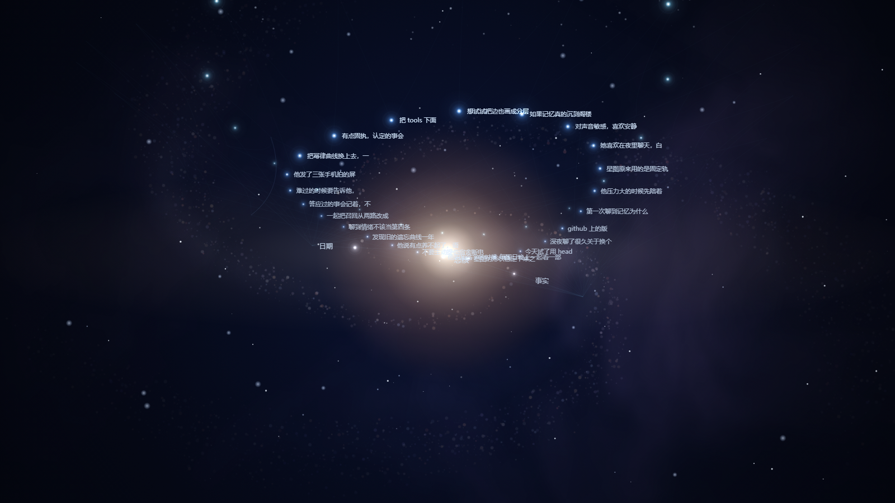
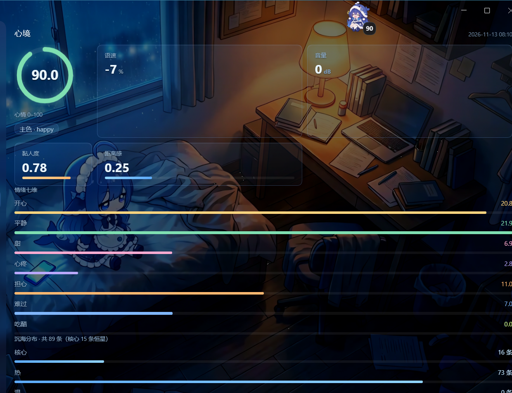

# 记忆星图 · dsh-nebula-mind

> Cross-session memory for DeepSeek Harness — it remembers you across restarts and compaction, forgets like the sea instead of deleting, and draws it as a galaxy where every edge explains itself.

给 DeepSeek Harness（DSH）用的**外置长期记忆**插件：把「她记得你」这件事从上下文窗口里拿出来，放进硬盘。

- 换会话、压缩上下文、重启应用，记忆都还在；
- 每一轮开头自动带一段「我是谁 + 你是谁 + 最近的几件事」进提示词（除「极简模式」外的会话）；
- 想翻旧事：四路召回（关键词 / 语义向量 / 图扩散 / 情绪共振），一条命令或一次点击；
- **遗忘不是删除**：记忆会按遗忘曲线慢慢「沉海」，越沉越难被想起，但永远不会消失，情绪刺激还能把它捞回来；
- 左侧栏有「记忆星图」和「心境」两个面板：星图可看可点，参数可调；心境是环表 + 数值卡 + 七维情绪条。

> 名字叫星图，是因为它真的画成一片星系：一条记忆一颗星，星与星之间的连线**每一条都写得出理由**。



> 上图是仓库内置的**示例数据**（20 条虚构的记忆 + 4 条画像），不是任何人的真实记忆。

---

## 它长什么样

- **左侧栏 → 记忆星图**：L0–L4 五层沉海阈值、四路检索权重、沉海与遗忘曲线参数，都能在界面里改，改完即时生效（写 `mind-config.json`）。
  - 面板底部有星图预览：遗忘推演滑杆（往后拖 0–365 天，看哪些星先暗下去）、视野（全部/一度/二度）、文字与线条开关、全屏。
- **左侧栏 → 心境**：心情环表（0–100）+ 六张数值卡 + 情绪七维条 + 沉海五层分布 + 分类标签 + 「此刻的由来」。
- **星图本身**是一个单文件 HTML（数据内联、零外部依赖），双击就能开：拖拽旋转、滚轮缩放、中键复位、点一颗星只看它那条星座、`V` 竖屏 9:16、`T` 文字开关、`H` 隐藏界面。

---


## 左侧栏两个面板

| 记忆星图（参数 / 预览） | 心境（仪表盘） |
|---|---|
|  |  |

- **记忆星图**：上面是活的星图预览（可推演遗忘、切一度/二度、开关文字与线条、重置视图），下面是可改的参数——L0–L4 各层检索权重、层间阈值、四路检索权重、RRF 常数、图扩散的跳数与衰减、沉海的上浮条件、遗忘曲线的半衰期与重要度/情绪倍数。
- **心境**：环形心情表 + 语速/音量/黏人度/距离感四张卡 + 七维情绪条 + 沉海五层分布。它读的是另一个心情插件（`dsh-feiyu-mood`）的状态文件，没有就按中性算。

> 两套截图里的数据都是我自己的机器跑出来的；星图那张用的是仓库里的示例数据。

## 安装

### 1. 装包

```bash
# 从 npm（上架后）
dsh plugin --profile desktop add dsh-nebula-mind

# 或者本地目录（开发时）
dsh plugin --profile desktop add link:/path/to/dsh-nebula-mind
```

装完**彻底退出并重开 DSH**（不是刷新页面），左侧栏才会出现两个入口。

### 2. 选一个 Python

插件自身的宿主是 Node（DSH 跑），但记忆库、召回、星图生成是 Python。需要 **Python 3.9+**：

```bash
# 用系统自带的就行
set NEBULA_PYTHON=C:\Python312\python.exe        # Windows
export NEBULA_PYTHON=/usr/bin/python3            # macOS / Linux
```

想要**语义检索**还得有向量模型（可选，没有也能用，只是少一路召回）：

```bash
pip install torch transformers
export NEBULA_BGE_DIR=/path/to/bge-small-zh-v1.5  # 约 95MB
```

> 没有 `NEBULA_BGE_DIR` 时插件会跳过向量这一路，BM25 + 图扩散 + 情绪照常工作。

### 3. 数据放哪

默认 `~/.dsh/nebula-mind/`：

```
~/.dsh/nebula-mind/
├── memory/          # 五本账 + 画像 + 向量 + 星图.html
└── logs/            # 夜间沉淀等日志
```

想放别处（比如 D 盘、同步盘），设一个环境变量就行：

```bash
set NEBULA_MIND=D:\my-memory       # 直接指定数据目录
# 或者
set NEBULA_HOME=E:\nebula          # 换根目录，数据在 E:\nebula\memory
```

**升级/卸载不会碰这个目录** —— 代码和记忆是分开的。

---

## 三步跑起来

```bash
# 1) 装（装完彻底退出 DSH 再重开）
dsh plugin --profile desktop add dsh-nebula-mind

# 2) 记下第一条（它同时会把这条算进向量索引）
python python/xin.py add "今天他提到周五要交画册"

# 3) 自检：哪几路检索开着、差什么、下一步干什么
python python/doctor.py
```

`doctor.py` 会逐项报告，并明确告诉你「缺了也能用」的部分。典型输出：

```
✅ Python       3.14.6
✅ 数据目录可写      ~/.dsh/nebula-mind/memory（2 本账）
✅ 记忆           事实 20 / 画像 4
⚠️ 语义检索         没有 torch/transformers（ModuleNotFoundError）
     ↳ 缺它也能用：关键词 / 图扩散 / 情绪共振照常
✅ 心情联动         ~/.dsh/feiyu-mood/state.json
✅ 星图生成         nebula-doctor.html（47 KB）
结论：5 项可用，1 项降级，0 项不可用
```

**没有 torch 也能用**：四路召回里只少「语义向量」这一路，另外三路（关键词、图扩散、情绪共振）照样跑；装了 torch 再跑一次 `python python/embed.py --build` 就有了。

## 记忆是怎么长出来的

| 账本 | 内容 | 谁写 |
|---|---|---|
| `notes.jsonl` | 事实（发生了什么） | 我，或 `xin.py add` |
| `summaries.jsonl` | 一段时间的归纳 | `xin.py sum` |
| `thoughts.jsonl` | 念想（没人时自己想的） | `xin.py think` |
| `promises.jsonl` | 约定（还作数 / 已过期） | `xin.py promise` |
| `tacts.jsonl` | 分寸（哪个话题提多少） | `xin.py tact` |
| `profile.jsonl` | 画像（我是谁 / 他是谁） | 我，钉成恒星 |

每条记录都带这些字段：

```
w        权重（写入时算：来源 × (1 + 惊讶度)）
imp      重要度 0~1
e/emo    情绪强度与颜色（happy/calm/sweet/heartache/worry/sad/jealous）
depth    沉海层：0 核心 · 1 热 · 2 温 · 3 深水 · 4 阁楼
pinned   恒星：永不沉、永不被清
hits     被想起过几次
valid_to 被新记忆取代的时间（不是删除，是「不再算数」）
```

**沉海**：`A = 2^(-天数 / (半衰期基数 × (1 + 重要度倍数 × imp)))`，按 A 分层；被召回得多会上浮，情绪同色且强烈会被拉回来。**没有任何一步会删掉记录。**

---

## 召回：四路并行

```
关键词（BM25）      字面命中
语义向量（可选）     意思相近
图扩散              共同关键词 / 同一天 ≤2h / 一跳二跳
情绪共振            当前心情同色且强度够
        ↓
   RRF 融合（Σ 1/(K+rank)）
```

命令行：

```bash
python python/xin.py recall "记忆架构"       # 混合召回
python python/xin.py recall "记忆架构" --kw  # 只看关键词，做对照
python python/xin.py digest                  # 打印注入用的那段摘要
python python/xin.py consolidate             # 手动跑一次沉海
python python/xin.py sink 事实 12            # 把某条往下沉一层
```

## 夜间巩固

每天 22:05（可在面板里改）：`consolidate` → 重建向量 → 重画星图。
没登录/关机那晚跳过，不补跑。

---

## 隐私

- 所有数据都在你自己机器上的 `NEBULA_MIND` 目录里，插件不上传任何东西；
- 注入到提示词的只有摘要那一段（默认 ≤1500 字），完整记忆不会一次性塞给模型；
- 向量模型是本地跑的（`bge-small-zh-v1.5`），不需要联网。

---

## 常见问题

**1. 装完左侧栏没有入口**
- 没彻底退出（要退进程，不是刷新）；
- `package.json` 必须写 `exports`，否则 `dsh-nebula-mind/client` 解析不到，而 `client-modules` 是 required 插件——整个应用会直接退出。这也是我踩过的坑，写在这里提醒后来人。

**2. 面板里全是「—」**
- 客户端请求要走**相对** `api/…`（桌面外壳是 `dsh-app://` 页面），写成 `/dsh-...` 会被拦。

**3. 提示词里没有【我是谁】那段**
- **除「极简模式」外都能注入**（标准模式、创造模式等）；极简模式用的是另一套精简提示词，不吃动态段；
- 看日志 `logs/yu-mind-boot.log`，有 `digest ready len=…`（非 0）和 `mounted … via context` 才算挂上。

**4. 保存按钮没反应**
- 桌面外壳会拦 POST。插件已改成 `GET /config?set=…`，如果还不行，看面板顶部那行提示写的失败原因。

---

## 开发

```bash
node --check lib/host.js
python -X utf8 python/star_map.py          # 只重画星图
python -X utf8 python/xin.py digest        # 只打印摘要
```

目录：

```
lib/host.js     宿主：路由、摘要生成、注入、夜间任务
lib/client.js   界面：左侧栏两个面板（记忆星图 / 心境）
python/         记忆库、召回、向量、星图生成
cordis.patch.yml  插件注入点
```

## License

MIT

## 沉海也会浮起来

夜里 22:05 的沉淀会做两件事：把新的记忆按「还新不新」分层沉下去，再从**最深的一层**里捞一条上来——
优先挑「沉得最深、又和此刻心情同色」的那条。捞上来的这条会写进 `心事本/resurfaced.json`，
下一次装配提示词时以「今晚浮起来的一条」出现在最前面。

不是随机抽奖，也不是故意煽情：沉到海底的东西本来就还在，只是需要一次洄游。

```bash
python python/xin.py resurface          # 手动捞一条（不写盘）
python python/xin.py resurface --dry    # 只看会捞到谁
```

## 星图 / 星河

左上角有切换按钮：

- **星图**：关系视图。星按关系和分类连，回答"谁和谁有关"。
- **星河**：时间视图。日期当横轴、分类当河道，一天一列，回答"什么时候发生的、隔多久回来一次"。

同一个页面，两种直觉。打开 `?river=1` 直接进星河。
